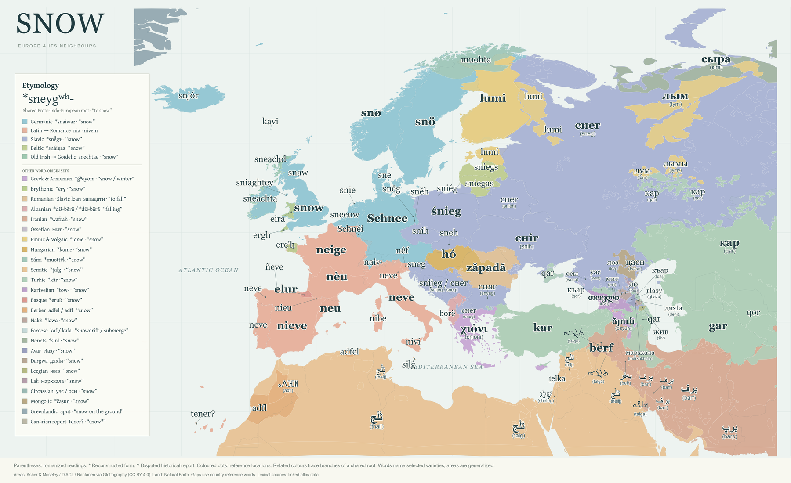

# Snow — A Word Map

[Live map](https://khayoon.github.io/snow-word-atlas/) · [Sources on the page](https://khayoon.github.io/snow-word-atlas/#sources) · [6,000px PNG](dist/downloads/snow-map-landscape-6000px.png) · [SVG](dist/downloads/snow-map-landscape.svg)



A browser editor for a flat landscape map of words for **snow** across Europe and its neighbours. The current lexicon contains **106 selected language/variety entries** grouped into **26 word-origin sets**. It includes native scripts, romanized readings for non-Latin words, schematic etymological chains, and source notes.

Export the composition as PNG at 6,000, 9,000 or 12,000 pixels wide, or as SVG. The default composition is 1800:1100; a 6,000-pixel PNG is 6000 × 3667. Controls and dialogs are excluded from exports. The legend uses Gentium Plus.

## Reading the map

- The default colours distinguish Germanic, Latin/Romance, Slavic, Baltic and Goidelic routes descending from the shared Proto-Indo-European snow root. Other established or unresolved origins have separate sets. Shared-roots and language-branch colour modes are also available.
- An asterisk marks an unattested reconstruction. Historical chains are schematic selections, including borrowing where stated; they are not complete sound histories.
- All source land in the selected map window is coloured. A **Natural Earth country reference layer** fills gaps beneath published language-area polygons. These background words are editorial references, not measurements of ethnicity, majority language, habitation or official status.
- Speaker areas come mainly from a 2007 atlas. Polygons overlap and retain disjoint areas; they are generalized source data, not a current census. Supplements for Occitan, Catalan, Cornish, Crimean Tatar, Northern Sami, Veps and the Kurdish supplements represent traditional ranges with source-specific epochs.
- The broad atlas Kurdish footprint combines varieties across Turkey, Syria, Iraq and Iran. It uses Northern Kurdish **berf** as a selected reference; Central Kurdish **befr** is separately labelled. Both use the Iranian snow-word colour. Published Kurmanji and Sorani traditional-area supplements are kept separately with their 1750 reference epoch. No new internal variety boundary is inferred.
- Some varieties have a representative word label without a separately asserted speaker-area polygon. A label or filled background does not imply exclusive language use.
- Parenthesized romanizations are reading aids, not IPA. Syrian Arabic **telj** and Mesopotamian Arabic **thelij** were supplied by the map author; local pronunciations and spellings vary. Their Arabic dictionary link supplies broader lexical/etymological context rather than independently documenting those exact readings.

## Run locally

No npm install or build step is required. With Node.js installed:

```sh
node local-server.mjs
```

Open the loopback URL printed in the terminal. On Windows, double-click `Open Snow Atlas.cmd`. All runtime libraries and map data are bundled; external dictionary links require internet access. Serve the files over HTTP rather than opening `dist/index.html` directly.

## Project data

| File | Contents |
| --- | --- |
| `dist/data/lexicon.json` | 106 entries; 26 root sets; historical chains, uncertainty notes and lexical links. |
| `dist/data/territories.geojson` | Published language-area polygons, aggregated and simplified with provenance properties. |
| `dist/data/land-reference.geojson` | Complete background land with selected reference-language IDs. |
| `dist/data/geometry-sources.json` | Geographic citations, versions, input hashes, transformations, licenses and caveats. |
| `dist/data/map-coverage.json` | Continuous-coverage method, source hashes and spatial checks. |
| `dist/app.js`, `dist/styles.css` | Composition, labels, interaction, legend and export logic. |
| `dist/vendor/` | Bundled D3, Gentium Plus fonts, vector legend outlines and license notices. |

## GitHub Pages

The static site is served from `dist/`. `.github/workflows/pages.yml` publishes it automatically when `main` changes; it can also be run manually from the Actions tab. Relative asset paths support the `/snow-word-atlas/` project URL. No server, API key or sign-in is required by the Pages site.

## Sources

The source catalog records the links attached to every entry and root. Wiktionary is a community-edited secondary resource; primary dictionaries, field grammars and historical accounts are identified in their entry notes.

### Geography

- **Asher, R. E. & Christopher J. Moseley (eds.) 2007. Atlas of the World's Languages. 2nd edn. Routledge.** — Contemporary speaker-area polygons; source atlas published in 2007, digitized dataset version 2.0. CC BY 4.0. [Dataset repository](https://github.com/Glottography/asher2007world) · [Dataset DOI](https://doi.org/10.5281/zenodo.18613195) · [Exact source GeoJSON](https://raw.githubusercontent.com/Glottography/asher2007world/5590fcc8870d8883a323ff0defd5a1a6a03e9611/cldf/contemporary/features.geojson)
- **Carling, Gerd & Jost Gippert (eds.) 2025. DiACL/TITUS Polygon Archive. Frankfurt am Main: Goethe University.** — Traditional areas for Catalan, Occitan, Cornish, Crimean Tatar, Northern Kurdish and Central Kurdish; reference year 1750, with source timeframes usually 1750–2000. CC BY 4.0. [Dataset repository](https://github.com/Glottography/carling2025diacl) · [Primary resource](https://diacl.uni-frankfurt.de/GeographicalPresence/Index) · [Derived dataset DOI](https://doi.org/10.5281/zenodo.18614010)
- **Rantanen, T., Vesakoski, O., Ylikoski, J., & Tolvanen, H. (2021). Geographical database of the Uralic languages (v1.0). Zenodo.** — Traditional Northern Sámi and Veps areas, approximately the widest known at the beginning of the 20th century. CC BY 4.0. [Dataset repository](https://github.com/Glottography/rantanen2021uralic) · [Original dataset DOI](https://doi.org/10.5281/zenodo.4784188) · [Derived dataset DOI](https://doi.org/10.5281/zenodo.18643660) · [Methods paper](https://doi.org/10.1371/journal.pone.0269648)
- **Natural Earth 1:50m Admin 0 – Countries** — Complete reference-language land fill underneath language polygons; country boundaries are not linguistic boundaries. Natural Earth public domain. [Source download](https://www.naturalearthdata.com/downloads/50m-cultural-vectors/50m-admin-0-countries-2/) · [Terms of use](https://www.naturalearthdata.com/about/terms-of-use/)
- **Glottolog 5.3: language reference locations** — Reference points for Maaloula Western Neo-Aramaic and Assyrian Neo-Aramaic; locations do not define speaker-area boundaries. CC BY 4.0. [Western Neo-Aramaic](https://glottolog.org/resource/languoid/id/west2763) · [Assyrian Neo-Aramaic](https://glottolog.org/resource/languoid/id/assy1241)

Aramaic labels distinguish Maaloula Western Neo-Aramaic, Assyrian Neo-Aramaic and Turoyo. Mandaic is a literary/liturgical reference near Basra. Where no suitable language-area polygon is documented, a location label is used.

Canarian tener? is a disputed historical report attributed to La Palma. The question mark is essential: this is not a secure reconstruction, and no relation to mainland Amazigh adfel is asserted. The island fill is a historical reference rather than a surviving speech area.

### Lexical, etymological, historical and romanization references

<details>
<summary>Complete list of 139 references</summary>

- [Avar Dictionary, Universitat Pompeu Fabra: гӀазу](https://avarlab.upf.edu/entry/220064/) — Avar; Avar (root set).
- [Bararan Armenian dictionary: ձյուն / dzyun](https://bararan.am/%D5%B1%D5%B5%D5%B8%D6%82%D5%B6) — Armenian.
- [Russian–Lak dictionary, Dagestan State University: снег / марххала, p. 327](https://cathedra.dgu.ru/Content/files/%D0%A4%D0%B8%D0%BB%D0%BE%D0%BB%D0%BE%D0%B3%D0%B8%D1%87%D0%B5%D1%81%D0%BA%D0%B8%D0%B9%20%D1%84%D0%B0%D0%BA%D1%83%D0%BB%D1%8C%D1%82%D0%B5%D1%82/%D0%93%D0%B0%D0%B4%D0%B6%D0%B8%D0%B5%D0%B2_%D0%A0%D1%83%D1%81%D1%81%D0%BA%D0%BE-%D0%BB%D0%B0%D0%BA%D1%81%D0%BA%D0%B8%D0%B9_%D1%81%D0%BB%D0%BE%D0%B2%D0%B0%D1%80%D1%8C.pdf) — Lak; Lak (root set).
- [Greenlandic–English Dictionary (University of Chicago and Oqaasileriffik, 2018): aput](https://daka.gl/2018-kal-eng/) — Greenlandic; Greenlandic (root set).
- [IEC: Diccionari catala-valencia-balear, neu](https://dcvb.iec.cat/results.asp?Id=99850&Word=neu&search=neu) — Catalan.
- [Real Academia Espanola: nieve](https://dle.rae.es/nieve) — Spanish.
- [Wiktionary: ñeve (Asturian)](https://en.wiktionary.org/wiki/%C3%B1eve#Asturian) — Asturian.
- [Wiktionary: śnieg (Polish)](https://en.wiktionary.org/wiki/%C5%9Bnieg#Polish) — Polish.
- [Wiktionary: χιόνι (Greek)](https://en.wiktionary.org/wiki/%CF%87%CE%B9%CF%8C%CE%BD%CE%B9#Greek) — Armenian; Greek; PIE · snow / winter (root set).
- [Wiktionary: кар (Kyrgyz)](https://en.wiktionary.org/wiki/%D0%BA%D0%B0%D1%80#Kyrgyz) — Kyrgyz.
- [Wiktionary: кар (Tatar)](https://en.wiktionary.org/wiki/%D0%BA%D0%B0%D1%80#Tatar) — Tatar.
- [Wiktionary: ло (Chechen)](https://en.wiktionary.org/wiki/%D0%BB%D0%BE#Chechen) — Chechen; Nakh · snow (root set).
- [Wiktionary: лум (Eastern Mari)](https://en.wiktionary.org/wiki/%D0%BB%D1%83%D0%BC#Eastern_Mari) — Meadow Mari.
- [Wiktionary: лым (Komi-Zyrian)](https://en.wiktionary.org/wiki/%D0%BB%D1%8B%D0%BC#Komi-Zyrian) — Komi-Zyrian.
- [Wiktionary: лымы (Udmurt)](https://en.wiktionary.org/wiki/%D0%BB%D1%8B%D0%BC%D1%8B#Udmurt) — Udmurt.
- [Wiktionary: мит (Ossetian)](https://en.wiktionary.org/wiki/%D0%BC%D0%B8%D1%82#Ossetian) — Ossetian; Ossetian · snow (root set).
- [Wiktionary: осы (West Circassian)](https://en.wiktionary.org/wiki/%D0%BE%D1%81%D1%8B#West_Circassian) — Adyghe; Circassian (root set); Kabardian.
- [Wiktionary: снег (Belarusian)](https://en.wiktionary.org/wiki/%D1%81%D0%BD%D0%B5%D0%B3#Belarusian) — Belarusian.
- [Wiktionary: снег (Macedonian)](https://en.wiktionary.org/wiki/%D1%81%D0%BD%D0%B5%D0%B3#Macedonian) — Macedonian.
- [Wiktionary: снег (Russian)](https://en.wiktionary.org/wiki/%D1%81%D0%BD%D0%B5%D0%B3#Russian) — Russian.
- [Wiktionary: сняг (Bulgarian)](https://en.wiktionary.org/wiki/%D1%81%D0%BD%D1%8F%D0%B3#Bulgarian) — Bulgarian.
- [Wiktionary: сніг (Ukrainian)](https://en.wiktionary.org/wiki/%D1%81%D0%BD%D1%96%D0%B3#Ukrainian) — Ukrainian.
- [Wiktionary: сыра (Tundra Nenets)](https://en.wiktionary.org/wiki/%D1%81%D1%8B%D1%80%D0%B0#Tundra_Nenets) — Samoyedic (root set); Tundra Nenets.
- [Wiktionary: уэс (East Circassian)](https://en.wiktionary.org/wiki/%D1%83%D1%8D%D1%81#East_Circassian) — Adyghe; Circassian (root set); Kabardian.
- [Wiktionary: цасн (Kalmyk)](https://en.wiktionary.org/wiki/%D1%86%D0%B0%D1%81%D0%BD#Kalmyk) — Kalmyk; Mongolic (root set).
- [Wiktionary: қар (Kazakh)](https://en.wiktionary.org/wiki/%D2%9B%D0%B0%D1%80#Kazakh) — Azerbaijani; Bashkir; Crimean Tatar; Kazakh; Kyrgyz; Tatar; Turkic · snow (root set); Turkish; Uzbek.
- [Wiktionary: ҡар (Bashkir)](https://en.wiktionary.org/wiki/%D2%A1%D0%B0%D1%80#Bashkir) — Bashkir.
- [Wiktionary: ձիւն (Old Armenian)](https://en.wiktionary.org/wiki/%D5%B1%D5%AB%D6%82%D5%B6#Old_Armenian) — Armenian; Greek; PIE · snow / winter (root set).
- [Wiktionary: ձյուն (Armenian)](https://en.wiktionary.org/wiki/%D5%B1%D5%B5%D5%B8%D6%82%D5%B6#Armenian) — Armenian.
- [Wiktionary: שלג (Hebrew)](https://en.wiktionary.org/wiki/%D7%A9%D7%9C%D7%92#Hebrew) — Arabic (standard reference); Egyptian Arabic; Hebrew; Maltese; Semitic · snow (root set); Tunisian Arabic.
- [Wiktionary: برف (Persian)](https://en.wiktionary.org/wiki/%D8%A8%D8%B1%D9%81#Persian) — Iranian · snow (root set); Northern Kurdish; Persian.
- [Wiktionary: برپ (Baluchi)](https://en.wiktionary.org/wiki/%D8%A8%D8%B1%D9%BE#Baluchi) — Balochi.
- [Wiktionary: بەفر (Central Kurdish)](https://en.wiktionary.org/wiki/%D8%A8%DB%95%D9%81%D8%B1#Central_Kurdish) — Central Kurdish.
- [Wiktionary: تلج (Egyptian Arabic)](https://en.wiktionary.org/wiki/%D8%AA%D9%84%D8%AC#Egyptian_Arabic) — Egyptian Arabic.
- [Wiktionary: ثلج (Arabic)](https://en.wiktionary.org/wiki/%D8%AB%D9%84%D8%AC#Arabic) — Arabic (standard reference); Egyptian Arabic; Hebrew; Maltese; Mesopotamian Arabic; Semitic · snow (root set); Syrian Arabic; Tunisian Arabic.
- [Wiktionary: ثلج (Tunisian Arabic)](https://en.wiktionary.org/wiki/%D8%AB%D9%84%D8%AC#Tunisian_Arabic) — Tunisian Arabic.
- [Wiktionary: თოვლი (Georgian)](https://en.wiktionary.org/wiki/%E1%83%97%E1%83%9D%E1%83%95%E1%83%9A%E1%83%98#Georgian) — Georgian; Kartvelian · snow (root set).
- [Wiktionary: ⴰⴷⴼⵍ (Central Atlas Tamazight)](https://en.wiktionary.org/wiki/%E2%B4%B0%E2%B4%B7%E2%B4%BC%E2%B5%8D#Central_Atlas_Tamazight) — Berber · snow (root set); Central Atlas Tamazight; Kabyle; Tachelhit.
- [Wiktionary: Appendix:Kabyle Swadesh list](https://en.wiktionary.org/wiki/Appendix:Kabyle%20Swadesh%20list) — Kabyle.
- [Wiktionary: Appendix:Nakh-Dagestanian Swadesh lists](https://en.wiktionary.org/wiki/Appendix:Nakh-Dagestanian%20Swadesh%20lists) — Avar; Avar (root set); Dargwa; Dargwa (root set); Lak; Lak (root set); Lezgian; Lezgian (root set).
- [Wiktionary: Tatar Swadesh list](https://en.wiktionary.org/wiki/Appendix:Tatar_Swadesh_list) — Tatar.
- [Wiktionary: Appendix:Turkic Swadesh lists](https://en.wiktionary.org/wiki/Appendix:Turkic%20Swadesh%20lists) — Karachay-Balkar; Kumyk.
- [Wiktionary: Reconstruction:Proto-Basque/eruR](https://en.wiktionary.org/wiki/Reconstruction:Proto-Basque/eruR) — Basque; Basque · snow (root set).
- [Wiktionary: Reconstruction:Proto-Brythonic/ėrɣ](https://en.wiktionary.org/wiki/Reconstruction:Proto-Brythonic/%C4%97r%C9%A3) — Breton; Brythonic · snow (root set); Cornish; Welsh.
- [Wiktionary: Reconstruction:Proto-Indo-European/snígʷʰs](https://en.wiktionary.org/wiki/Reconstruction:Proto-Indo-European/sn%C3%ADg%CA%B7%CA%B0s) — Aragonese; Asturian; Belarusian; Bulgarian; Catalan; Czech; Danish; Dutch; English; French; Friulian; Galician; German; Icelandic; Irish; Italian; Kashubian; Latvian; Lithuanian; Lower Sorbian; Luxembourgish; Macedonian; Manx; Norwegian; Occitan; PIE · to snow (root set); Polish; Portuguese; Romansh; Russian; Sardinian; Scots; Scottish Gaelic; Serbian–Croatian–Bosnian; Sicilian; Slovak; Slovenian; Spanish; Swedish; Ukrainian; Upper Sorbian; Venetian; West Frisian.
- [Wiktionary: Reconstruction:Proto-Indo-European/snóygʷʰos](https://en.wiktionary.org/wiki/Reconstruction:Proto-Indo-European/sn%C3%B3yg%CA%B7%CA%B0os) — Aragonese; Asturian; Belarusian; Bulgarian; Catalan; Czech; Danish; Dutch; English; French; Friulian; Galician; German; Icelandic; Irish; Italian; Kashubian; Latvian; Lithuanian; Lower Sorbian; Luxembourgish; Macedonian; Manx; Norwegian; Occitan; PIE · to snow (root set); Polish; Portuguese; Romansh; Russian; Sardinian; Scots; Scottish Gaelic; Serbian–Croatian–Bosnian; Sicilian; Slovak; Slovenian; Spanish; Swedish; Ukrainian; Upper Sorbian; Venetian; West Frisian.
- [Wiktionary: Reconstruction:Proto-Indo-European/sneygʷʰ-](https://en.wiktionary.org/wiki/Reconstruction:Proto-Indo-European/sneyg%CA%B7%CA%B0-) — Aragonese; Asturian; Belarusian; Bulgarian; Catalan; Czech; Danish; Dutch; English; French; Friulian; Galician; German; Icelandic; Irish; Italian; Kashubian; Latvian; Lithuanian; Lower Sorbian; Luxembourgish; Macedonian; Manx; Norwegian; Occitan; PIE · to snow (root set); Polish; Portuguese; Romansh; Russian; Sardinian; Scots; Scottish Gaelic; Serbian–Croatian–Bosnian; Sicilian; Slovak; Slovenian; Spanish; Swedish; Ukrainian; Upper Sorbian; Venetian; West Frisian.
- [Wiktionary: Reconstruction:Proto-Iranian/wafrah](https://en.wiktionary.org/wiki/Reconstruction:Proto-Iranian/wafrah) — Bakhtiari; Balochi; Central Kurdish; Northern Luri; Southern Luri.
- [Wiktionary: Reconstruction:Proto-Nakh/lawa](https://en.wiktionary.org/wiki/Reconstruction:Proto-Nakh/lawa) — Ingush.
- [Wiktionary: Reconstruction:Proto-Sami/muottëk](https://en.wiktionary.org/wiki/Reconstruction:Proto-Sami/muott%C3%ABk) — Northern Sámi; Sámi · snow (root set).
- [Wiktionary: Reconstruction:Proto-Turkic/kār](https://en.wiktionary.org/wiki/Reconstruction:Proto-Turkic/k%C4%81r) — Karachay-Balkar; Kumyk; Turkmen.
- [Wiktionary: Reconstruction:Proto-Uralic/lome](https://en.wiktionary.org/wiki/Reconstruction:Proto-Uralic/lome) — Estonian; Finnish; Karelian; Komi-Zyrian; Meadow Mari; Udmurt; Uralic · snow (root set); Veps.
- [Wiktionary: Schnéi (Luxembourgish)](https://en.wiktionary.org/wiki/Schn%C3%A9i#Luxembourgish) — Luxembourgish.
- [Wiktionary: Schnee (German)](https://en.wiktionary.org/wiki/Schnee#German) — German.
- [Wiktionary: Dargwa transliteration (following Gippert / TITUS)](https://en.wiktionary.org/wiki/Wiktionary:Dargwa_transliteration) — Dargwa.
- [Wiktionary: adfl (Tashelhit)](https://en.wiktionary.org/wiki/adfl#Tashelhit) — Berber · snow (root set); Central Atlas Tamazight; Kabyle; Tachelhit.
- [Wiktionary: berf (Northern Kurdish)](https://en.wiktionary.org/wiki/berf#Northern_Kurdish) — Iranian · snow (root set); Northern Kurdish; Persian.
- [Wiktionary: borë (Albanian)](https://en.wiktionary.org/wiki/bor%C3%AB#Albanian) — Albanian; Albanian · falling (root set).
- [Wiktionary: eira (Welsh)](https://en.wiktionary.org/wiki/eira#Welsh) — Welsh.
- [Wiktionary: elur (Basque)](https://en.wiktionary.org/wiki/elur#Basque) — Basque; Basque · snow (root set).
- [Wiktionary: erc'h (Breton)](https://en.wiktionary.org/wiki/erc'h#Breton) — Breton.
- [Wiktionary: ergh (Cornish)](https://en.wiktionary.org/wiki/ergh#Cornish) — Cornish.
- [Wiktionary: gar (Turkmen)](https://en.wiktionary.org/wiki/gar#Turkmen) — Turkmen.
- [Wiktionary: hó (Hungarian)](https://en.wiktionary.org/wiki/h%C3%B3#Hungarian) — Hungarian; Uralic · snow (root set).
- [Wiktionary: kar (Turkish)](https://en.wiktionary.org/wiki/kar#Turkish) — Azerbaijani; Bashkir; Crimean Tatar; Kazakh; Kyrgyz; Tatar; Turkic · snow (root set); Turkish; Uzbek.
- [Wiktionary: kavi (Faroese)](https://en.wiktionary.org/wiki/kavi#Faroese) — Faroese; Norse: snowdrift / submerge (root set).
- [Wiktionary: lumi (Estonian)](https://en.wiktionary.org/wiki/lumi#Estonian) — Estonian.
- [Wiktionary: lumi (Finnish)](https://en.wiktionary.org/wiki/lumi#Finnish) — Estonian; Finnish; Karelian; Meadow Mari; Udmurt; Uralic · snow (root set); Veps.
- [Wiktionary: lumi (Karelian)](https://en.wiktionary.org/wiki/lumi#Karelian) — Karelian.
- [Wiktionary: lumi (Veps)](https://en.wiktionary.org/wiki/lumi#Veps) — Veps.
- [Wiktionary: muohta (Northern Sami)](https://en.wiktionary.org/wiki/muohta#Northern_Sami) — Northern Sámi; Sámi · snow (root set).
- [Wiktionary: nèu (Occitan)](https://en.wiktionary.org/wiki/n%C3%A8u#Occitan) — Occitan.
- [Wiktionary: nêf (Friulian)](https://en.wiktionary.org/wiki/n%C3%AAf#Friulian) — Friulian.
- [Wiktionary: naiv (Romansh)](https://en.wiktionary.org/wiki/naiv#Romansh) — Romansh.
- [Wiktionary: neige (French)](https://en.wiktionary.org/wiki/neige#French) — French.
- [Wiktionary: neu (Catalan)](https://en.wiktionary.org/wiki/neu#Catalan) — Catalan.
- [Wiktionary: neve (Galician)](https://en.wiktionary.org/wiki/neve#Galician) — Galician.
- [Wiktionary: neve (Italian)](https://en.wiktionary.org/wiki/neve#Italian) — Italian.
- [Wiktionary: neve (Portuguese)](https://en.wiktionary.org/wiki/neve#Portuguese) — Portuguese.
- [Wiktionary: neve (Venetian)](https://en.wiktionary.org/wiki/neve#Venetan) — Venetian.
- [Wiktionary: nibe (Sardinian)](https://en.wiktionary.org/wiki/nibe#Sardinian) — Sardinian.
- [Wiktionary: nieu (Aragonese)](https://en.wiktionary.org/wiki/nieu#Aragonese) — Aragonese.
- [Wiktionary: nieve (Spanish)](https://en.wiktionary.org/wiki/nieve#Spanish) — Spanish.
- [Wiktionary: nivi (Sicilian)](https://en.wiktionary.org/wiki/nivi#Sicilian) — Sicilian.
- [Wiktionary: qar (Azerbaijani)](https://en.wiktionary.org/wiki/qar#Azerbaijani) — Azerbaijani.
- [Wiktionary: qar (Crimean Tatar)](https://en.wiktionary.org/wiki/qar#Crimean_Tatar) — Crimean Tatar.
- [Wiktionary: qor (Uzbek)](https://en.wiktionary.org/wiki/qor#Uzbek) — Uzbek.
- [Wiktionary: silġ (Maltese)](https://en.wiktionary.org/wiki/sil%C4%A1#Maltese) — Arabic (standard reference); Egyptian Arabic; Hebrew; Maltese; Semitic · snow (root set); Tunisian Arabic.
- [Wiktionary: sníh (Czech)](https://en.wiktionary.org/wiki/sn%C3%ADh#Czech) — Czech.
- [Wiktionary: snö (Swedish)](https://en.wiktionary.org/wiki/sn%C3%B6#Swedish) — Swedish.
- [Wiktionary: snø (Norwegian)](https://en.wiktionary.org/wiki/sn%C3%B8#Norwegian) — Norwegian.
- [Wiktionary: sněg (Lower Sorbian)](https://en.wiktionary.org/wiki/sn%C4%9Bg#Lower_Sorbian) — Lower Sorbian.
- [Wiktionary: sněh (Upper Sorbian)](https://en.wiktionary.org/wiki/sn%C4%9Bh#Upper_Sorbian) — Upper Sorbian.
- [Wiktionary: snaw (Scots)](https://en.wiktionary.org/wiki/snaw#Scots) — Scots.
- [Wiktionary: sne (Danish)](https://en.wiktionary.org/wiki/sne#Danish) — Danish.
- [Wiktionary: sneachd (Scottish Gaelic)](https://en.wiktionary.org/wiki/sneachd#Scottish_Gaelic) — Scottish Gaelic.
- [Wiktionary: sneachda (Scottish Gaelic)](https://en.wiktionary.org/wiki/sneachda#Scottish_Gaelic) — Scottish Gaelic.
- [Wiktionary: sneachta (Irish)](https://en.wiktionary.org/wiki/sneachta#Irish) — Irish.
- [Wiktionary: snechtae (Old Irish)](https://en.wiktionary.org/wiki/snechtae#Old_Irish) — Irish; Manx; Scottish Gaelic.
- [Wiktionary: sneeuw (Dutch)](https://en.wiktionary.org/wiki/sneeuw#Dutch) — Dutch.
- [Wiktionary: sneg (Slovenian)](https://en.wiktionary.org/wiki/sneg#Slovenian) — Slovenian.
- [Wiktionary: sneh (Slovak)](https://en.wiktionary.org/wiki/sneh#Slovak) — Slovak.
- [Wiktionary: sniég (Kashubian)](https://en.wiktionary.org/wiki/sni%C3%A9g#Kashubian) — Kashubian.
- [Wiktionary: sniaghtey (Manx)](https://en.wiktionary.org/wiki/sniaghtey#Manx) — Manx.
- [Wiktionary: snie (West Frisian)](https://en.wiktionary.org/wiki/snie#West_Frisian) — West Frisian.
- [Wiktionary: sniegas (Lithuanian)](https://en.wiktionary.org/wiki/sniegas#Lithuanian) — Lithuanian.
- [Wiktionary: sniegs (Latvian)](https://en.wiktionary.org/wiki/sniegs#Latvian) — Latvian.
- [Wiktionary: snijeg (Serbo-Croatian)](https://en.wiktionary.org/wiki/snijeg#Serbo-Croatian) — Serbian–Croatian–Bosnian.
- [Wiktionary: snjógvur (poetic / archaic)](https://en.wiktionary.org/wiki/snj%C3%B3gvur#Faroese) — Faroese.
- [Wiktionary: snjór (Icelandic)](https://en.wiktionary.org/wiki/snj%C3%B3r#Icelandic) — Icelandic.
- [Wiktionary: snow](https://en.wiktionary.org/wiki/snow) — Bakhtiari.
- [Wiktionary: snow (English)](https://en.wiktionary.org/wiki/snow#English) — English.
- [Wiktionary: zăpadă (Romanian)](https://en.wiktionary.org/wiki/z%C4%83pad%C4%83#Romanian) — Romanian; Slavic · fall (root set).
- [Johanna Nichols, UC Berkeley: Ingush Swadesh word list](https://linguistics.berkeley.edu/~ingush/swadesh.html) — Ingush.
- [Oqaasileriffik, Language Secretariat of Greenland: terms for snow and ice](https://oqaasileriffik.gl/en/terms-for-snow-and-ice/) — Greenlandic; Greenlandic (root set).
- [Russian Wiktionary: жив (Lezgian)](https://ru.wiktionary.org/wiki/%D0%B6%D0%B8%D0%B2#%D0%9B%D0%B5%D0%B7%D0%B3%D0%B8%D0%BD%D1%81%D0%BA%D0%B8%D0%B9) — Lezgian; Lezgian (root set).
- [Institute of the Estonian Language: Transliteration of Dargwa, TITUS column](https://transliteration.eki.ee/pdf/Dargwa.pdf) — Dargwa.
- [Institute of the Estonian Language: Transliteration of Lak, ALA-LC column](https://transliteration.eki.ee/pdf/Lakh.pdf) — Lak.
- [Dallet's Kabyle–French dictionary: adfel](https://www.dictionnaire-kabyle.com/adfel.html) — Berber · snow (root set); Central Atlas Tamazight; Kabyle; Tachelhit.
- [Euskaltzaindia: elur, dictionary entry (PDF)](https://www.euskaltzaindia.eus/dok/iker_jagon_tegiak/67699.pdf) — Basque.
- [Oyggjar English-Faroese lexicon: snow / kavi](https://www.oyggjar.com/faroese.php) — Faroese.
- [Alonso de Espinosa, Del origen y milagros de la Santa Imagen de Nuestra Señora de Candelaria (1594), book I chapter1, fol.9v](https://archive.org/details/delorigenymilagr00espi) — Canarian report (root set); Indigenous Canarian (La Palma; disputed report).
- [Carmen Díaz Alayón and Francisco Javier Castillo, Estudio de la lista de voces prehispánicas de Juan Bautista Lorenzo Rodríguez, Almogaren 44–45 (2013–2014), pp.7–56, especially p.35](https://www.almogaren.org/ic-digital/ICDigital_Almogaren_44-45_1_%282014%29.pdf) — Canarian report (root set); Indigenous Canarian (La Palma; disputed report).
- [Juan Álvarez Delgado, Miscelánea guanche (1941), printed pp.46–48](https://hdiecan.org/wp-content/uploads/tainacan-items/5/6717/ALVAREZ-1941-Miscelanea-guanche.pdf#page=50) — Canarian report (root set); Indigenous Canarian (La Palma; disputed report).
- [Maximiano Trapero, Los Guanchismos, entry Tenerife / Tinefe / Tenerista (ULPGC)](https://guanchismos.ulpgc.es/item/14417) — Canarian report (root set); Indigenous Canarian (La Palma; disputed report).
- [Werner Arnold, Western Neo-Aramaic, The Semitic Languages, pp. 685–696, esp. p. 689 (2011/2012)](https://doi.org/10.1515/9783110251586.685) — Western Neo-Aramaic (Maaloula).
- [Full handbook PDF used to inspect Arnold's p. 689 table](https://joverfelt.net/wp-content/uploads/2021/09/the-semitic-languages-an-international-handbook-handbucc88cher-zur-sprach-und-kommunikationswissenschaft-by-stefan-weninger-geoffrey-khan-michael-p.-streck-janet-c.-e.-watson-.pdf) — Western Neo-Aramaic (Maaloula).
- [Geoffrey Khan, Verbal Forms Expressing Discourse Dependency in North-Eastern Neo-Aramaic, p. 163 (2021)](https://books.openbookpublishers.com/10.11647/obp.0209.04.pdf) — Assyrian Neo-Aramaic.
- [Sureth Online Dictionary, snow (Oraham / Bailis Shamun; entry marked Classical Syriac)](https://www.assyrianlanguages.org/sureth/dosearch.php?language=id&searchkey=15578) — Assyrian Neo-Aramaic.
- [Wiktionary: ܬܠܓܐ, Assyrian Neo-Aramaic reference orthography, reading and etymology](https://en.wiktionary.org/wiki/%DC%AC%DC%A0%DC%93%DC%90#Assyrian_Neo-Aramaic) — Assyrian Neo-Aramaic.
- [Cambridge North-Eastern Neo-Aramaic Database: dialect region and language varieties](https://nena.ames.cam.ac.uk/) — Assyrian Neo-Aramaic.
- [Glottolog: Assyrian Neo-Aramaic reference location](https://glottolog.org/resource/languoid/id/assy1241) — Assyrian Neo-Aramaic.
- [Šlomo Surayt: An Introductory Course to Surayt-Aramaic (Turoyo), lesson 1.6 Vocabulary, Aramaic Online Project](https://textbook.surayt.com/en/Level%20A/1.6?content-fragment-id=1743) — Turoyo / Surayt.
- [Barsky, Kalinin and Loesov (2018), The Basic Lexicon of Mlaḥsô: A Comparative Study, p. 232](https://www.ub.edu/ipoa/wp-content/uploads/2021/07/20182AuOrBarsky.pdf) — Turoyo / Surayt.
- [Qais Al-Saadi, Nhura: English–Mandaic / Mandaic–Mandaic Dictionary (2012), p.93; also p.204](https://qadaha.wordpress.com/wp-content/uploads/2021/03/nhura-dictionary-mandaic-english-mandaic.pdf#page=94) — Mandaic (Mandaean liturgical reference).
- [Comprehensive Aramaic Lexicon, tlg / tlgʾ](https://cal.huc.edu/oneentry.php?cits=all&lemma=tlg+N) — Mandaic (Mandaean liturgical reference).
- [Charles G. Häberl, The Neo-Mandaic Dialect of Khorramshahr (2009), pp.42,113](https://scholarship.libraries.rutgers.edu/esploro/outputs/book/The-Neo-Mandaic-Dialect-of-Khorramshahr/991031550027404646) — Mandaic (Mandaean liturgical reference).
- [Chiara Stornaiuolo, šèleg – snow, Semantics of Ancient Hebrew Database, §1 A.1,A.4](https://sahd-online.com/words/sheleg/) — Mandaic (Mandaean liturgical reference).
- [Encyclopaedia Iranica: Mandaean communities in southern Iraq and Iran; modern language distinctions](https://www.iranicaonline.org/articles/mandaeans/mandaeans-iv-community-in-iran/) — Mandaic (Mandaean liturgical reference).

</details>

### Typography, software and licences

- [Gentium Plus Regular and Bold](https://github.com/google/fonts/tree/main/ofl/gentiumplus) — SIL Open Font License 1.1.
- [D3 7.9.0](https://d3js.org) — ISC.
- [SIL International](http://www.sil.org/) — Copyright holder named in GentiumPlus-OFL.txt, copyright 2003–2022 SIL International..
- [Noto Sans Syriac and Noto Sans Mandaic](https://github.com/notofonts/noto-fonts) — SIL Open Font License 1.1.

Geometry attributed by Glottography is CC BY 4.0; Natural Earth geography is public domain. Wiktionary content is identified as CC BY-SA 4.0; other dictionaries retain their own terms. D3 retains its ISC notice; Gentium Plus and Noto retain their SIL OFL notices in `dist/vendor/`. No blanket project licence is imposed on the original code or mixed third-party data.

The machine-readable [source catalog](dist/data/source-catalog.json) preserves original URL spellings and root/language citation contexts. Run `python scripts/update-references.py` after updating the attributed lexicon to refresh these lists.
